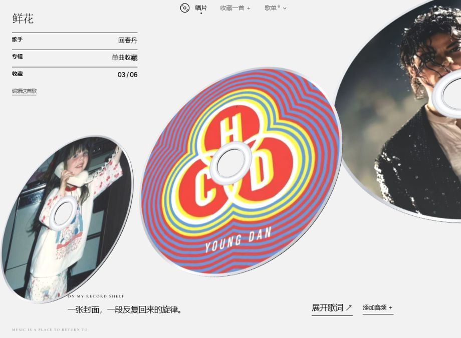
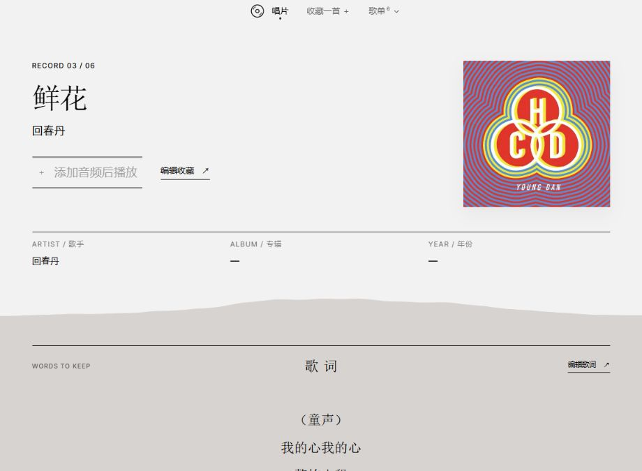

# Music of Love

**把喜欢的声音，留在一个愿意反复打开的地方。**



Music of Love 是一个可以翻看、旋转、阅读和聆听的私人音乐角。喜欢的封面被印在光盘上，点开唱片，进入这首歌的歌词页；再为它添加一段听歌手记或自己的音频，让一首歌和属于它的记忆放在一起。

网站采用原生 HTML、CSS 与 JavaScript，使用 Three.js 绘制 3D 光盘，使用 GSAP 编排过渡。可直接分发的成品是一个 `index.html`，仓库同时保留模块源文件，方便继续修改。

## 先看见封面，再走进一首歌

首页把唱片沿着有纵深的斜线排开。当前收藏在画面中央展开，前后的封面仍露出一部分，让人知道唱片架还可以继续翻。歌名、歌手与收藏编号退到一侧，用细线组织信息，把画面的大部分空间留给封面。

浅灰背景、黑色细线和大面积留白贯穿全站。封面承担色彩与情绪，界面保持安静。标题使用衬线字体，标签与操作采用清晰的无衬线字体；小号编号、SIDE A 式的唱片语言和纸面排版，把数字页面与实体收藏的记忆联系起来。

## 设计中的细节

### 1. 一张光盘有正面，也有背面

每张唱片由真实的 3D 网格组成：环形正面、反面、外侧边缘和中心孔侧壁。封面被居中裁切后绘制成纹理，中心环与细小的金属边框再叠加其上。拖动时能看见薄薄的侧面，圆孔也保留了空间感。

正面与背面使用不同的材质参数。正面保留印刷封面的颜色，背面采用较高的金属度与更低的粗糙度，并加入细密同心纹理和轻微的彩色反光。环境光照让角度变化同时带来明暗变化，因此旋转传达的是一件物体的重量与质感。

### 2. 松手之后，动作还有余韵

横向拖动会记录移动速度，松开后继续旋转，并逐步衰减。速度较低时，弹簧回正逻辑把封面带回容易阅读的位置。轻拨和快速甩动有不同的响应，形成拿起、翻看、放回的手感。

切换唱片时，空间位置平滑靠近目标，文字也按切换方向退场与进入。滚轮输入设置了累积阈值和短暂间隔，避免触控板的一次滑动连续跳过许多首歌。

### 3. 用一圈手绘墨线表示“这一张”

鼠标停留在当前光盘上，会出现略带不规则的墨线。曲线先在光盘所在的 3D 空间生成，再投影到屏幕，交给 SVG 绘制。因此它能跟随唱片的角度，而不是固定贴在页面上的圆框。

墨线沿路径逐渐画出，离开后再收走。这个反馈延续了手写标记的感觉，也让封面本身始终清楚可见。

### 4. 从唱片架进入一张歌词纸



打开歌曲后，画面从立体陈列转向平面的阅读秩序：歌名、歌手、封面和播放入口位于上方，歌词从下面的暖灰纸面展开。

两个区域之间的边缘由一条动态路径生成。较大的起伏配合细小的不规则波动，再用曲线连接，构成轻微的纸张撕边。它会随时间与滚动产生细微变化，让区域切换有材质感，同时保持正文区域稳定。

桌面端把封面收在右侧的紧凑栏中；移动端改为纵向排列并缩小封面，让歌词尽早进入视野。页面底部提供明确的“下一首”入口，读到末尾不会自动跳走，停留多久由读者决定。

### 5. 歌词有自己的呼吸与层次

普通歌词保留换行与空行，空行成为段落之间的停顿。正文居中排列、限制行宽，并用较宽的行距让逐句阅读更从容。

韩文与中文同时存在时，页面会识别相邻原词与译文，以字体和字号区分层次；中文歌中的英文句子不会因此把后续中文原词误排成小号译文。作词、作曲信息放在正文前的小字区，附注以独立的较轻文字显示。

导入带时间标记的 LRC 后，歌词按时间排序，并在播放时高亮当前句。普通文本不会被编造时间轴；没有音频时，也可以完整阅读。

### 6. 收藏与聆听可以分两步完成

封面、歌词与音频可以分别补充。只上传封面和歌词，也是一张成立的收藏。音频为空时，页面明确显示“添加音频后播放”；不会用假进度条模拟播放。

添加自己的音频后，底部播放器提供播放、暂停、拖动进度、上一首与下一首。播放状态跟随浏览器音频事件更新；切换唱片架与歌词页时，使用同一个音频实例，音乐可以继续播放。打开或刷新页面不会自动播放。

### 7. 把不同设备和操作方式一起考虑

- **鼠标与触控板：** 滚轮切歌，横向拖动旋转，点击当前光盘展开歌词。
- **手机：** 纵向滑动切歌，横向拖动旋转；手势开始后区分方向，减少两种操作互相干扰。
- **键盘：** 方向键切换唱片，光盘获得焦点后按 Enter 打开歌词，Escape 收起歌单。
- **辅助信息：** 当前歌曲通过状态区域播报，播放进度提供可读时间，按钮和封面包含文字说明。
- **减少动态效果：** 读取系统的 `prefers-reduced-motion` 偏好，简化主要入场、切换和文字动画。
- **渲染开销：** 限制渲染像素比，页面进入后台时跳过场景渲染，替换封面时释放旧纹理。

## 当前唱片架

| 歌曲 | 歌手 |
| --- | --- |
| Celebrity（名人） | IU |
| Call Me Maybe | Carly Rae Jepsen |
| 鲜花 | 回春丹 |
| Billie Jean | Michael Jackson |
| 麦恩莉 (My only) | 方大同 |
| 暗恋 | 沙一汀EL |

封面和已有歌词由收藏者提供。当前预置歌曲的音频均留空，可在页面中随后添加。仓库内的默认内容以 `src/music-data.js` 为准。

## 本地打开

下载或克隆仓库，在仓库根目录执行：

```bash
python -m http.server 4173 --bind 127.0.0.1
```

然后打开 **[http://127.0.0.1:4173/](http://127.0.0.1:4173/)**。建议固定使用同一个浏览器与地址，以便继续读取原来的收藏。

无需安装 npm 依赖，也不需要后端服务。运行时需要支持 JavaScript、WebGL 与 IndexedDB 的现代浏览器；Three.js `0.160.0` 和 GSAP `3.12.5` 仍需联网从 CDN 加载。字体与预置封面已嵌入成品 HTML。

## 添加自己的收藏

1. 点击顶部“收藏一首 ＋”，填写歌名与歌手，选择封面图片。
2. 粘贴已有歌词，或选择 TXT / LRC 文件；用空行区分段落。
3. 可以填写专辑、年份和“关于这首歌”，留下自己的听歌回忆。
4. 需要播放时，展开“为这首歌添加播放来源”，选择自己的音频文件，再保存。
5. 在已有歌曲中点击“编辑收藏”，可以更换封面、补充歌词或音频，也可以移出收藏。

播放来源支持本地音频文件、可直接访问的音频链接，以及跳转到音乐平台的分享链接。具体音频格式能否播放取决于浏览器支持。平台分享链接会在新页面打开，不会被当成音频文件解析。

## 本地保存与 GitHub 的区别

**页面内的修改保存在当前浏览器的 IndexedDB 中，不会自动写回 `index.html`，也不会自动提交或同步到 GitHub。**

图片和音频以 Blob 保存在本地，页面使用对象 URL 读取；无需把自己的音频上传到网站服务器。刷新同一个地址可以继续使用已保存的收藏。如果浏览器不允许持久化，页面会提示本次内容只能临时保留。

不同浏览器、设备、域名和端口拥有各自的存储。例如，本地预览与未来的线上地址是两套独立收藏。清除站点数据会移除该浏览器里的本地内容，请保留自己原始的封面、歌词和音频文件。

若要把新增歌曲作为所有访客都能看见的默认收藏，需要更新 `src/music-data.js`，重新生成 `index.html`，再提交仓库。默认歌曲使用稳定 ID；首次出现的新条目会合并进歌单，已经从本地移出的默认歌曲不会因刷新重新出现。

## 项目结构与修改方式

```text
Music-of-Love/
├── index.html                 # 可直接运行和分发的单文件成品
├── README.md
├── docs/
│   └── images/                # README 封面与页面截图
├── scripts/
│   └── build.py               # 合并源模块，生成 index.html
└── src/
    ├── music-app.js           # 3D 场景、手势、路由与页面衔接
    ├── music-data.js          # 预置收藏与内容更新
    ├── music-library.js       # 收藏编辑器与 IndexedDB
    ├── music-detail.js        # 歌词解析、阅读页与撕边路径
    ├── music-player.js        # 音频播放与底部播放器
    ├── music-body.html        # 页面基础结构
    ├── music-*.css            # 对应模块的样式
    ├── shell.css              # 共用页面样式
    └── fonts.css              # 内嵌字体
```

修改 `src/` 中的文件后，在仓库根目录运行：

```bash
python scripts/build.py
```

脚本会重新生成根目录 `index.html`。提交时同时保留源文件和更新后的成品，既方便阅读与维护，也方便直接打开和部署。直接编辑成品后再运行脚本，会被源文件生成的版本覆盖。

未来补充音频时，可以先在本地编辑器中选择文件，即刻使用现有播放器；如需把音频作为网站的公开默认内容，再单独整理媒体文件与默认数据并发布。唱片架、歌词页和播放功能已经通过同一条歌曲 ID 连接起来，可以继续逐首扩充。
